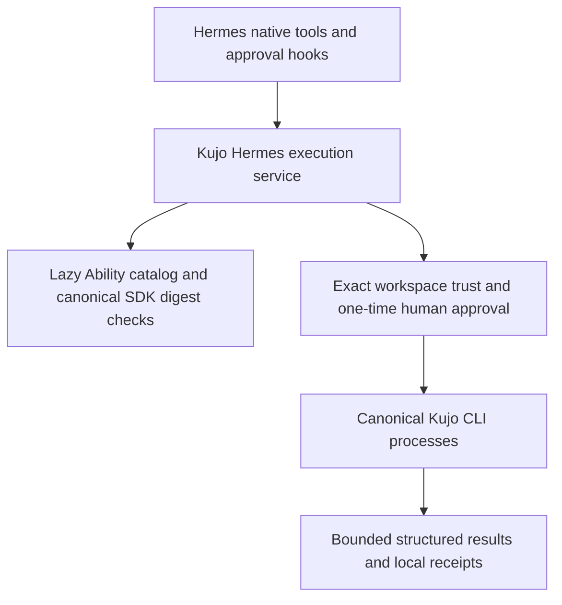

# Architecture

`plugin.py` handles Hermes integration through the public `ctx.register_tool`, `register_hook`, `register_command`, `register_skill`, `on_unload`, plugin storage and secret-scope APIs. It uses no private host imports, core overrides or other host plugins. A matching `post_approval_response` event authorizes one normalized request. Stale, automatic, denied and unmatched events grant no permission.

`Catalog` loads portable Ability definitions on demand and validates them with the upstream Python SDK preview. The vendored SDK includes its commit, checksum and license. It checks contracts and digests; the underlying Kujo tools own execution and policy. JSON schemas are validated locally without fetching remote references. CLI bindings use `kujo.hermes.receipt/v1`, a separate schema from canonical runtime receipts.

`commands.py` builds argument arrays for canonical tools. It applies schema defaults before approval and resolves explicit file and path arguments within the trusted workspace. Tool-specific relative-path rules still apply. Tools may interpret their own repository configuration, so workspace trust does not provide a sandbox.

`process.py` starts POSIX process groups, drains stdout and stderr, provides no stdin, and kills descendants on timeout, cancellation or unload. It allows four concurrent jobs and prunes completed job objects. Output defaults to 512 KiB per invocation, with a 12,000-character limit for model-facing results. Exceeding the process output limit stops execution. JSON is stored once with the original stdout hash; other output remains labeled stdout.

`Service` creates a separate receipt for each invocation and hashes the redacted evidence. Missing, altered or symlinked receipt files fail verification. Each page request verifies the whole receipt before returning a slice. Hashes detect changes but cannot establish authenticity against someone who controls receipt storage.

The bundled catalog contains 38 reference Ability definitions and profiles from Kujo CMD, without its executable code. Thirteen additional bindings call Workcell, Loop, MCP generation and language/runtime interfaces. Operators can add definitions through an absolute `extension_catalogs` path with a declarative argv binding. Every new extension requires approval, even if it declares read-only effects. Repository content cannot choose executables, policy or catalogs. The inventory lists producer catalogs that still lack bindings; there is no universal `kujo ability` CLI.

Registration performs no network requests, source scans or subprocess work. First discovery reads the bounded catalog. An explicit refresh replaces the catalog only after validation succeeds. Background work is opt-in, and `on_unload` cancels owned processes. Operators install sources and manage optional services.

The live Hermes test verified deferred discovery: the model used `tool_search`, `tool_describe` and `tool_call` to select and invoke the six native tools.
