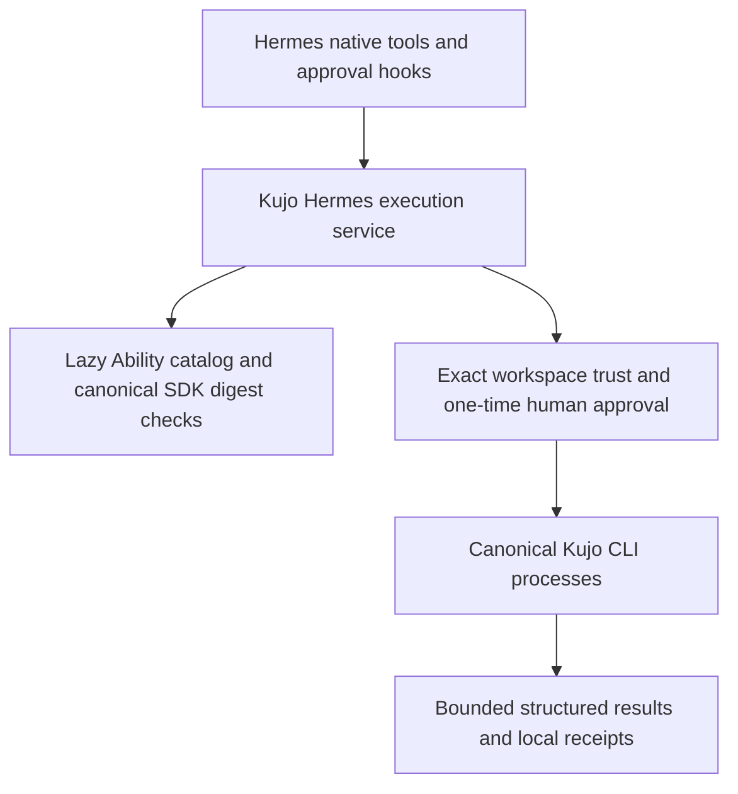

# Architecture

`plugin.py` is the only host integration module. It uses documented `ctx.register_tool`, `register_hook`, `register_command`, `register_skill`, `on_unload`, plugin storage and secret scope. No private host imports, core replacement or other host-plugin dependencies. Native hooks run the host-owned human gate. A matching `post_approval_response` event admits exactly one normalized request; stale, automatic, denied or unmatched events do not.

`Catalog` lazily validates portable Ability definitions through the upstream Python SDK preview (vendored verbatim with commit, checksum and license). It validates JSON schemas locally without remote reference fetching. The preview validates contracts/digests; it is not misrepresented as the canonical Kujo execution runtime. Domain products own their handlers and policies. Local CLI bindings use a separately named `kujo.hermes.receipt/v1` evidence envelope, never counterfeit canonical runtime receipts.

`commands.py` owns native argv routing. Product algorithms remain upstream. Schema defaults are applied before approval. All explicit file/path arguments resolve within the trusted workspace; tool-specific relative-path requirements remain enforced. Canonical products can interpret their own configuration, so workspace trust is a real operator decision, not a sandbox claim.

`process.py` runs isolated POSIX process groups, drains both streams, bounds total bytes, denies stdin, and terminates descendants on timeout/cancellation/unload. Four concurrent jobs maximum; completed job objects are pruned. Default output is 512 KiB per invocation, 12,000 characters in model-facing results. Oversized output terminates execution rather than growing memory without bound. JSON output is stored once with the original stdout hash; non-JSON remains tagged stdout.

`Service` writes per-invocation exclusive receipts with hashes over redacted evidence. Missing, tampered or symlinked receipt files fail closed. Receipt pages verify the complete record before slicing. Hashes detect accidental alteration; they do not prove authenticity against a storage owner.

Discovery: 38 reference Ability definitions/profiles are semantic data derived from the inspected Kujo CMD catalog; its executable code is not reused. Thirteen additional Hermes-owned projections invoke canonical Workcell, Loop, MCP generation and language/runtime interfaces. A new installed definition can be supplied through an operator-reviewed absolute `extension_catalogs` path with a declarative argv binding. Unknown/new definitions always require approval, including those claiming read-only effects. Repository content never selects executables, policy or catalogs. The inventory records producer-owned catalogs not yet bound; there is no invented global `kujo ability` CLI.

Lifecycle: registration does no network, source scan or subprocess work. The first discovery reads the bounded catalog. Refresh is explicit and transactional. Background work is opt-in per invocation; `on_unload` cancels owned processes. No service is automatically started or silently repaired. Installed sources and optional services remain operator-owned.

The live Hermes conversation also verified the host's deferred tool wrappers: the model used `tool_search`, `tool_describe` and `tool_call` to select and invoke these six native registrations. No private lazy-registration API is required.
